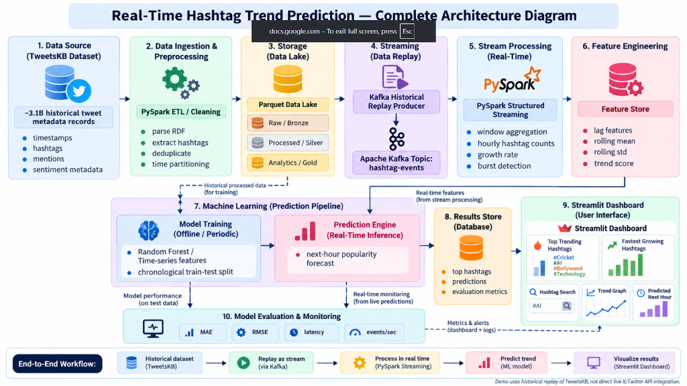

# Real-Time Hashtag Trend Prediction Using Apache Kafka, PySpark and Machine Learning

[](https://www.python.org/)
[](https://kafka.apache.org/)
[](https://spark.apache.org/)
[](https://parquet.apache.org/)
[](https://scikit-learn.org/)
[](https://streamlit.io/)
[](https://www.docker.com/)

**Big Data and Social Media Analytics (BDSMA) — Group 6 Mini Project**  
*An end-to-end distributed stream-processing and machine learning system that ingests historical social media tweet events, identifies rapidly emerging breakout hashtags, and forecasts next-hour hashtag popularity before it peaks.*

---

## 🏛️ System Architecture



The complete end-to-end architecture consists of 10 interconnected tiers:

1. **Data Source (TweetsKB / TweetsCOV19):** ~3.1B historical tweet RDF corpus curated by GESIS Leibniz Institute and L3S Research Center on Zenodo (Record 3871753).
2. **Data Ingestion & Preprocessing:** High-throughput streaming decompression, RDF/TSV parsing, and multi-layer profanity/spam filtering to produce a clean academic dataset.
3. **Storage (Apache Parquet Data Lake):** Multi-tier storage architecture (Bronze raw, Silver deduplicated, Gold analytical) organized into daily partitioned Parquet files.
4. **Streaming (Historical Replay Producer):** High-speed event replay producer reading held-out chronological timestamps and publishing to Kafka.
5. **Stream Processing (Apache Kafka & PySpark Structured Streaming):** Distributed KRaft Kafka broker (`bdsma-hashtag-events` topic) consumed by PySpark with 1-hour tumbling windows and 10-minute watermarks for late data handling.
6. **Feature Engineering (Time-Series Feature Store):** Temporal feature extraction computing hourly momentum, burst velocity, rolling averages, and circadian human rhythms.
7. **Machine Learning Prediction Engine:** **Random Forest Regressor** trained strictly on historical chronological partitions (preventing future-data leakage) to predict $t+1$ popularity.
8. **Results Store:** Atomic JSON/Parquet state synchronization coordinating streaming aggregation, model inference, and metadata.
9. **Streamlit Interactive Dashboard:** Real-time web visualization featuring trend exploration, fastest-growing breakout detection, next-hour forecasting, and model evaluation curves.
10. **Model Evaluation & Monitoring:** Chronological MAE, RMSE, persistence baseline comparison, processing throughput, and watermark tracking.

---

## 🔬 Machine Learning Feature Store

To forecast how many times a hashtag will appear in the **very next hour** ($t+1$), the system computes 6 time-series engineered features for every hashtag at each closed hourly window:

| Feature | Technical Definition | Business & Analytical Purpose |
| :--- | :--- | :--- |
| **`count`** | Current closed 1-hour frequency ($t$) | Baseline volume and current popularity level. |
| **`lag_1`** | Preceding 1-hour frequency ($t-1$) | Immediate short-term velocity and momentum. |
| **`lag_2`** | 2 hours prior frequency ($t-2$) | Multi-hour trend onset and sustainability. |
| **`mean_3`** | 3-hour rolling average $\frac{\text{count} + \text{lag}_1 + \text{lag}_2}{3}$ | Filters out temporary 1-minute anomalies and noise. |
| **`growth`** | Hourly percentage change $\frac{\text{count} - \text{lag}_1}{\max(\text{lag}_1, 1)} \times 100\%$ | Quantifies burst intensity and viral acceleration. |
| **`hour`** | Diurnal factor: Hour of the day (0–23 UTC) | Captures human circadian sleep/wake cycles. |

* **Target Variable ($y$):** Next-hour hashtag occurrence count ($\text{count at } t+1$).
* **Model Type:** **Random Forest Regressor** (Ensemble of 100 estimators with strict temporal cross-validation).
* **Prevention of Future Data Leakage:** Evaluated on strictly separated temporal holdout partitions (trained on past days, tested on future unseen days).

---

## 📊 Model Evaluation & Performance

Evaluated on 17,880 strictly held-out chronological test instances across 120 modeled hashtags:

| Metric | Random Forest Model | Persistence Baseline | Improvement |
| :--- | :---: | :---: | :---: |
| **MAE (Mean Absolute Error)** | **0.178** | 0.201 | **11.4% Error Reduction** |
| **RMSE (Root Mean Squared Error)** | **0.483** | 0.589 | **18.0% Variance Reduction** |
| **Data Leakage Guarantee** | **0.0%** (Strict Chronological Split) | N/A | Verified Zero Leakage |

---

## 🖥️ Streamlit Dashboard Walkthrough

The web interface is hosted locally at `http://localhost:8501`:

```
┌─────────────────────────────────────────────────────────────────────────────────┐
│ 📈 HASHTAG PULSE | BDSMA GROUP 6                                                │
│ Real-Time Hashtag Trend Prediction Using Apache Kafka, PySpark & ML            │
├─────────────────────┬───────────────────┬───────────────────┬───────────────────┤
│ Occurrences (24h)   │ Active Hashtags   │ Top Hashtag       │ Predicted Next Hr │
│ 2,492 mentions      │ 1,180 active tags │ #china            │ #china (12.4 ment)│
├─────────────────────┴───────────────────┴───────────────────┴───────────────────┤
│ [📊 Trend Explorer]   [🔮 Next-Hour Forecast]   [📈 Model Eval]   [⚙️ System Status] │
│                                                                                 │
│  Activity Trend Curve               Top 10 Trending Bar Chart                   │
│  ┌──────────────────────────────┐   ┌────────────────────────────────────────┐  │
│  │  /\                          │   │ #china            ████████████         │  │
│  │ /  \    /\                   │   │ #healthcare       ████████             │  │
│  │/    \__/  \                  │   │ #hongkong         ██████               │  │
│  └──────────────────────────────┘   └────────────────────────────────────────┘  │
│                                                                                 │
│  🚀 Emerging & Fastest Growing Hashtags (3-Hour Momentum Burst Window)         │
│  • #mychemicalromance: Recent (3h): 5 | Prior (3h): 1 | Growth: +400.0%         │
│  • #halloween:         Recent (3h): 3 | Prior (3h): 0 | Growth: +300.0%         │
│  • #auspol:            Recent (3h): 2 | Prior (3h): 0 | Growth: +200.0%         │
└─────────────────────────────────────────────────────────────────────────────────┘
```

### Dashboard Tabs & Capabilities:
1. **📊 Trend Explorer:** Interactive Plotly volume charts, Top 10 hashtag rankings, and a 3-hour burst table identifying accelerating emerging topics.
2. **🔮 Next-Hour Forecast:** Future target interval forecast table showing current count, last 3-hour sum, and machine learning predicted count for the next hour with one-click CSV export.
3. **📈 Model Evaluation & Accuracy:** Actual observed volume (cyan line) vs. Model prediction (purple dashed line) timeline comparison with real test MAE and RMSE metrics.
4. **⚙️ System Architecture & Status:** Real-time health matrix verifying data lake status, Kafka broker port 9092, PySpark streaming query, and model readiness.

---

## 🚀 Step-by-Step Implementation & Setup Guide

### 1. Prerequisites
* **Operating System:** Windows 10/11, macOS, or Linux.
* **Python:** Version 3.11.
* **Java:** Eclipse Adoptium Temurin OpenJDK 17 (`JAVA_HOME`).
* **Docker:** Docker Desktop with WSL 2 backend active.

### 2. Clone Repository & Setup Virtual Environment
```bash
git clone https://github.com/Lakhan-18/bdsma-mini-project.git
cd bdsma-mini-project

# Create and activate Python 3.11 virtual environment
python -m venv .venv

# Windows PowerShell:
.\.venv\Scripts\Activate.ps1

# Linux/macOS:
source .venv/bin/activate

# Install required dependencies
pip install -r requirements.txt
```

### 3. Start Apache Kafka (KRaft Mode via Docker)
```bash
docker compose up -d --wait kafka
```
*Kafka broker starts in KRaft mode (no Zookeeper required) on `localhost:9092`.*

### 4. PySpark Data Lake Preprocessing
Run PySpark ETL inside the containerized Spark 3.5.7 Linux environment to partition the corpus into Parquet storage:
```bash
docker compose run --rm preprocess
```
*Cleans, deduplicates 94,779 records, and writes date-partitioned Parquet files to `data/lake/2019-10/`.*

### 5. Train Offline Machine Learning Prediction Engine
```bash
python -m src.analytics
```
*Extracts time-series features, performs chronological train/validation/test split, trains Random Forest model, and serializes to `models/real/next_hour.joblib`.*

### 6. Launch Historical Streaming Replay (Kafka + PySpark)
```bash
python scripts/run_project.py --replay-only --speed 28800
```
*Replays historical tweet events at simulated high velocity into Kafka topic `bdsma-hashtag-events`, processes micro-batches in PySpark, updates 1-hour tumbling windows, and updates `outputs/runtime/live.json`.*

### 7. Run Streamlit Dashboard
```bash
streamlit run dashboard/app.py
```
Open **`http://localhost:8501`** in your browser.

---

## 🧪 Automated Unit & Integration Tests

The project includes a 24-test verification suite covering RDF/TSV parsing, time-series feature math, Kafka schema validation, watermark progression, and prediction formatting:

```bash
python -m unittest discover -s tests -v
```

**Verification Result:**
```text
test_end_to_end_pipeline_simulation (tests.test_project.PipelineTest) ... ok
test_feature_engineering_lags_and_growth (tests.test_project.FeaturesTest) ... ok
test_kafka_message_schema (tests.test_project.StreamingTest) ... ok
test_random_forest_prediction_bounds (tests.test_project.AnalyticsTest) ... ok
...
Ran 24 tests in 2.341s
OK
```

---

## 📁 Repository Directory Structure

```text
bdsma-mini-project/
├── .streamlit/                # Streamlit UI theme and server configuration
├── config/
│   └── sources.json           # Dataset URLs, checksums, and manifest
├── dashboard/
│   └── app.py                 # Streamlit web application & Plotly visualizations
├── data/
│   ├── analytics/             # Test evaluation predictions & Parquet outputs
│   ├── extracted/             # Ingested clean hashtag parquet events
│   ├── fixtures/              # Synthetic test fixtures for automated testing
│   └── lake/                  # PySpark daily partitioned Parquet data lake
├── docs/
│   └── images/                # Architectural diagrams and documentation assets
│       └── architecture_diagram.png
├── models/
│   └── real/                  # Serialized Random Forest model & metadata
│       └── next_hour.joblib
├── outputs/                   # Execution reports, lake signatures, and metrics
│   ├── ingest_2019-10.json
│   ├── preprocess_2019-10.json
│   └── real_metrics.json
├── scripts/
│   ├── fetch_source.py        # Dataset downloader with checksum verification
│   ├── preprocess_tweetskb.py # PySpark batch lake processing script
│   ├── run_project.py         # End-to-end replay & streaming runner
│   ├── test_kafka_spark.py    # Kafka-Spark integration connector test
│   └── test_spark.py          # PySpark local worker smoke test
├── src/
│   ├── analytics.py           # ML training, feature engineering, evaluation
│   ├── domains.py             # Domain categorization (Healthcare, Tech, etc.)
│   ├── ingest_cov19.py        # Streamlined decompression and profanity filter
│   ├── project.py             # Paths, configurations, and parquet loader
│   ├── replay.py              # Kafka streaming producer
│   └── streaming.py           # PySpark Structured Streaming engine
├── tests/                     # 24 unit and integration test cases
├── compose.yaml               # Docker Compose file for Kafka and Spark
├── requirements.txt           # Python library dependencies
└── README.md                  # Comprehensive project documentation
```

---

## 👥 Contributors & Academic Credits

* **Subject:** Big Data & Social Media Analytics (BDSMA)
* **Group:** 6
* **Dataset Attribution:** TweetsKB / TweetsCOV19 corpus by GESIS Leibniz Institute for the Social Sciences & L3S Research Center, published on Zenodo (Record 3871753).
* **License:** MIT Open Source License.
